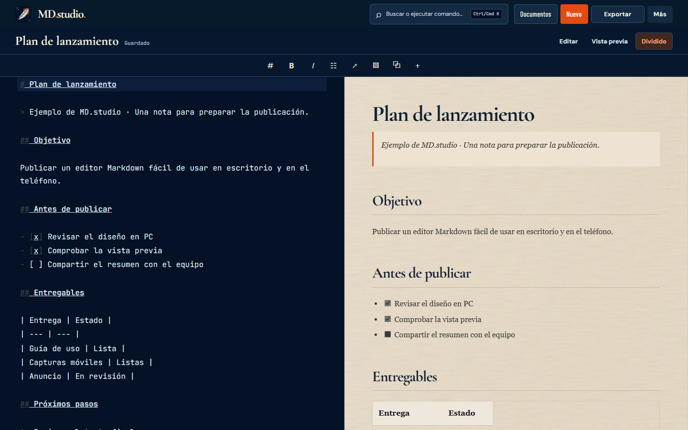
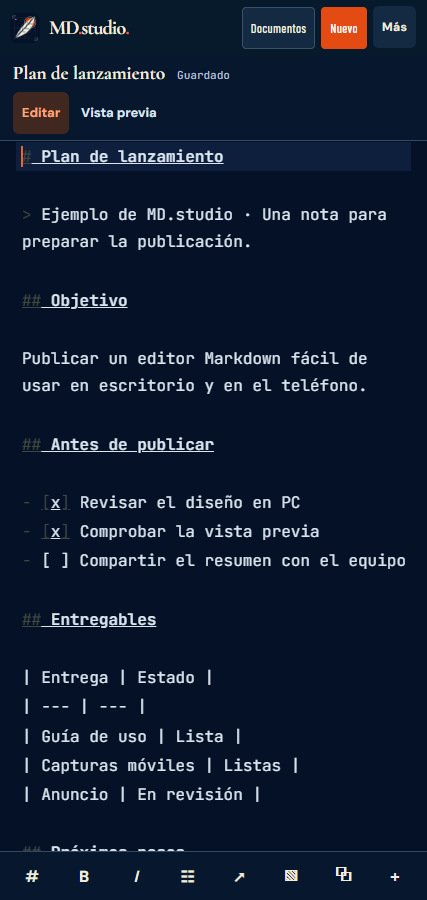
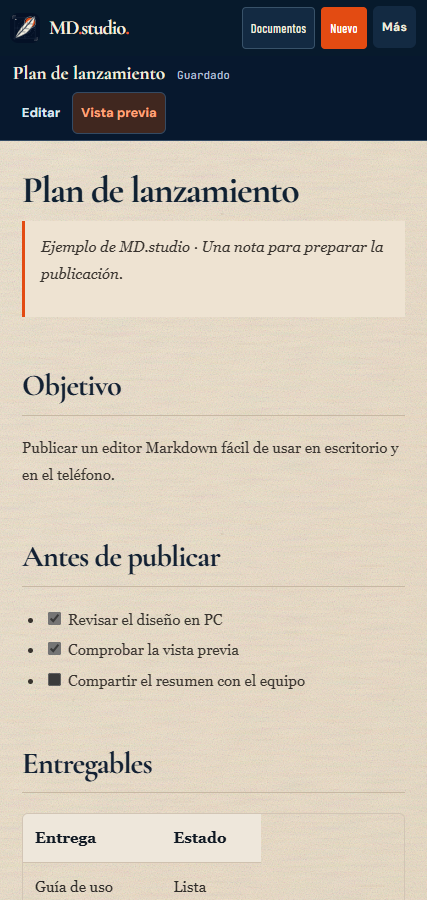
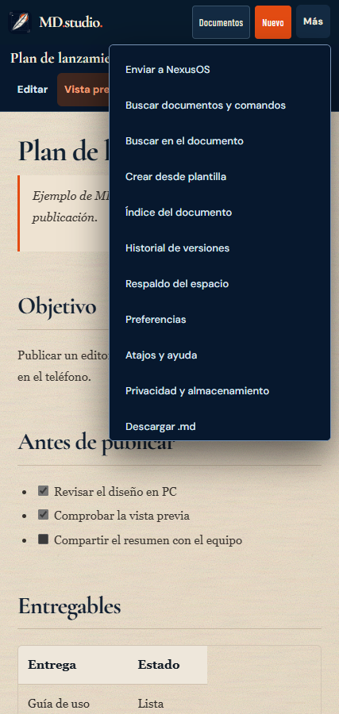

<div align="center">


# MD.studio

**Un editor Markdown para escribir y revisar notas en PC y móvil.**

Abre una nota en blanco, revisa el resultado en una hoja de lectura y guarda tus documentos en el navegador.


[**Abrir MD.studio**](https://md.rck1996.dev/) · [Recorrido](#tour) · [Empezar](#start) · [Desarrollo](#build) · [Calidad](#quality) · [Documentación](#docs) · [Reportar un problema](https://github.com/rck1996/md-studio/issues/new)

</div>

> **En producción.** MD.studio está disponible en [md.rck1996.dev](https://md.rck1996.dev/). La [galería](docs/SCREENSHOTS.md) muestra la app publicada con datos de ejemplo en escritorio y móvil emulado.

<a id="tour"></a>
## Recorrido



En escritorio, **Dividido** muestra el Markdown y la vista previa juntos. En móvil, **Editar** y **Vista previa** alternan entre dos pantallas completas y la barra de formato queda junto al teclado.

| Quiero… | Dónde | Qué puedo hacer |
| :--- | :--- | :--- |
| Escribir | **Nuevo** | Abrir una nota en blanco y empezar a escribir |
| Revisar | **Vista previa** | Leer Markdown renderizado con encabezados, tablas, listas e imágenes |
| Organizar | **Documentos** | Abrir, buscar y ordenar notas en carpetas |
| Dar formato | **Barra de formato** o **/** | Insertar encabezados, listas, enlaces, imágenes y bloques |
| Empezar con una estructura | **Más → Crear desde plantilla** | Elegir una plantilla de reunión, proyecto u otro tipo de nota |
| Volver a una versión | **Más → Historial de versiones** | Revisar y restaurar instantáneas locales |
| Llevarme el contenido | **Exportar** en PC o **Más** en móvil | Descargar Markdown, HTML o recursos, o imprimir como PDF |
| Cambiar de dispositivo | **Más → Respaldo del espacio** | Descargar o restaurar el espacio completo en ZIP |

<details open>
<summary><strong>Ver la app en móvil</strong></summary>

| Editar | Vista previa | Compartir |
| :---: | :---: | :---: |
|  |  |  |

</details>

[Ver las capturas de biblioteca, plantillas, búsqueda, exportación, historial y respaldo →](docs/SCREENSHOTS.md)

<a id="start"></a>
## Empieza a escribir

1. Abre [MD.studio](https://md.rck1996.dev/) y pulsa **Nuevo**.
2. Escribe Markdown o usa la barra de formato para insertar encabezados, enlaces y listas.
3. Cambia a **Vista previa** para revisar el resultado.
4. Pulsa **Documentos** para volver a una nota anterior o **Exportar** para guardar una copia fuera del navegador.

<details>
<summary><strong>Probar con una nota de ejemplo</strong></summary>

```markdown
# Plan de lanzamiento

> Ejemplo de MD.studio · Una nota para preparar la publicación.

## Antes de publicar

- [x] Revisar el diseño en PC
- [x] Comprobar la vista previa
- [ ] Compartir el resumen con el equipo

| Entrega | Estado |
| --- | --- |
| Guía de uso | Lista |
| Anuncio | En revisión |
```

</details>

## Enviar una nota a NEXUS OS

En Android, abre una nota y pulsa **Más → Enviar a NexusOS**. Selecciona **NEXUS OS** en el menú de compartir. Si tu versión de NEXUS OS incluye el receptor Markdown, podrás revisar la nota en **Importar nota** y guardarla allí.

Se envían el título y una copia del texto Markdown. Las referencias a imágenes guardadas en el navegador se reemplazan por un aviso. Si el navegador no ofrece la función de compartir, MD.studio descarga un archivo `.md`. [Protocolo de importación de NEXUS OS](https://github.com/rck1996/NexusOS/blob/main/docs/MARKEDDOWN_HANDOFF.md)

## Datos y respaldo

Las notas, carpetas, imágenes y preferencias viven en el almacenamiento de cada navegador. Usa **Más → Respaldo del espacio** para guardar un ZIP antes de cambiar de navegador o equipo. Restaurarlo reemplaza el espacio local tras confirmar. Un archivo `.md` exporta una nota individual.

Puedes instalar MD.studio desde **Más** cuando el navegador ofrece esa opción. Tras la primera carga, el servicio de caché de la aplicación permite abrir el editor sin conexión en navegadores compatibles.

<a id="build"></a>
## Desarrollo

Requiere Node.js **20.19+ o 22.12+** y npm.

```bash
git clone https://github.com/rck1996/md-studio.git
cd md-studio
npm ci
npm run dev
```

`npm run build` genera `dist/`. `npm run preview` abre esa compilación de forma local. Cloudflare Pages construye la rama `main` con `npm run build` y sirve `dist/` en [md.rck1996.dev](https://md.rck1996.dev/).

| Ruta | Qué contiene |
| :--- | :--- |
| `src/app/` | Edición, navegación, almacenamiento, respaldo y exportación |
| `src/editor/` | Integración con CodeMirror |
| `src/domain/` | Documentos, carpetas, recursos y Markdown |
| `src/styles/` | Diseño del editor, lector y pantallas adaptables |
| `public/` | Iconos, manifiesto y caché para la app instalable |

<a id="quality"></a>
## Calidad

```bash
npm test
npm run build
```

La CI comprueba las conexiones de la interfaz, la paleta, las descargas y la preparación del Markdown para NEXUS OS. La galería muestra la versión publicada a **1440 × 900** y **427 × 900**. La prueba móvil emulada cubre escritura, vista previa, búsqueda y menú. El selector nativo depende del navegador Android y de las aplicaciones instaladas. [Guía de verificación](docs/MOBILE-UI-VERIFICATION.md)

<a id="docs"></a>
## Documentación

| Guía | Contenido |
| :--- | :--- |
| [Galería](docs/SCREENSHOTS.md) | Pantallas actuales de PC y móvil |
| [Arquitectura](docs/ARCHITECTURE.md) | Capas de la aplicación y almacenamiento |
| [Estructura del proyecto](docs/PROJECT-STRUCTURE.md) | Dónde vive cada pieza del código |
| [Roadmap](docs/ROADMAP.md) | Estado y próximas verificaciones |

## Licencia

El repositorio es público y no incluye un archivo `LICENSE` que otorgue permisos de reutilización.
