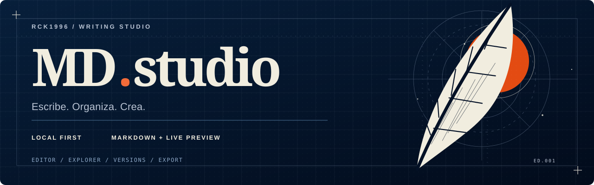
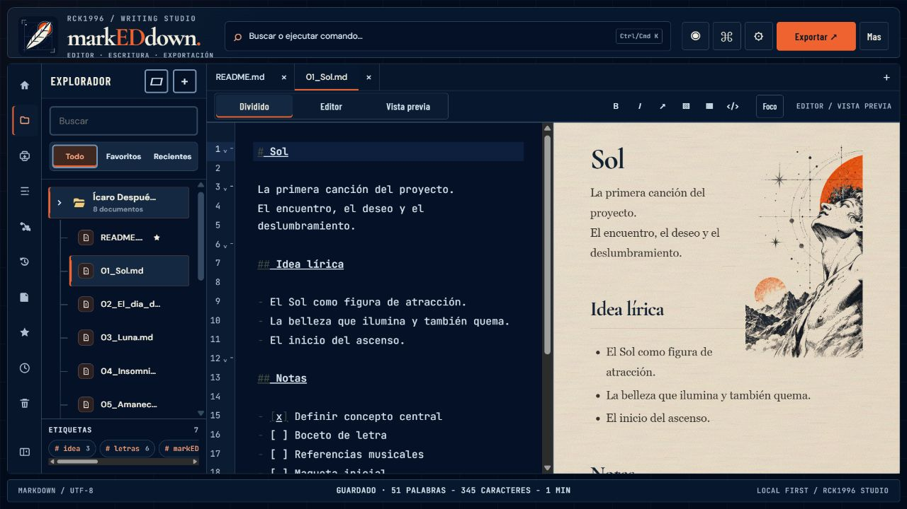
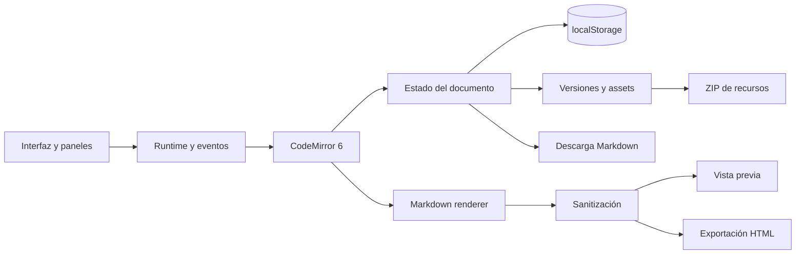

<div align="center">



# markEDdown

**Un espacio para escribir, organizar y crear.**

Editor Markdown **local-first** con vista previa en vivo, documentos organizados, historial de versiones y exportación.  
Pensado para escribir sin distracciones ni cuentas obligatorias.


[**Abrir el editor ↗**](https://markeddown.rck1996.dev/) · [Recorrido](#tour) · [Pantallas](docs/SCREENSHOTS.md) · [Empezar](#start) · [Desarrollo](#build) · [Calidad](#quality) · [Roadmap](#roadmap) · [Docs](#docs)

</div>

> [!IMPORTANT]
> **Estado actual.** El rediseño editorial ya está integrado en `main`. El editor publicado está en [markeddown.rck1996.dev](https://markeddown.rck1996.dev/); la integración en `main` no confirma por sí sola que el despliegue haya terminado. Las capturas reales de sus vistas principales están en la [galería de pantallas](docs/SCREENSHOTS.md). La versión `1.0.0` corresponde a `package.json`, no a una release pública certificada.

<a id="tour"></a>
## ✦ Conoce el espacio de trabajo

En escritorio, markEDdown presenta **Explorador · Editor · Vista previa**. En el móvil, permite alternar entre la escritura y la lectura sin comprimir el documento.

| Quiero… | Abro… | Qué hace |
| :--- | :--- | :--- |
| ✍️ Escribir | **Editor** | CodeMirror 6, Markdown, búsqueda/reemplazo y comandos con `/` |
| 👁️ Revisar el resultado | **Vista previa** | Renderizado vivo y lectura tipográfica |
| 🗂️ Ordenar ideas | **Explorador** | Documentos, carpetas, favoritos, recientes, archivo y papelera |
| 🧩 Insertar elementos | **Insertar** | Listas, encabezados, imágenes, tablas, citas y bloques de código |
| 🧭 Recorrer el texto | **Índice** | Encabezados, plegado y reordenación de secciones |
| 🕘 Recuperar una versión | **Historial** | Instantáneas locales y restauración |
| 🖼️ Gestionar recursos | **Assets / Inspector** | Imágenes, notas por bloque y avisos de validación |
| 📤 Exportar | **Exportar** | Menú propio para `.md`, HTML, ZIP de recursos y copiar Markdown/HTML |

<details>
<summary><strong>🖥️ Cómo se organiza la interfaz</strong></summary>

```text
┌────────────────── markEDdown / RCK1996 STUDIO ──────────────────┐
│  Marca                 Editor / Dividido / Vista previa   Exportar │
├───────────────┬───────────────────────┬──────────────────────────┤
│ EXPLORADOR    │ SOURCE / MARKDOWN     │ VISTA PREVIA / EN VIVO   │
│               │                       │                          │
│ 📂 Proyectos  │ # Documento           │ Documento                │
│  └ README.md  │                       │                          │
│ 📂 Notas      │ ## Ideas              │ Ideas                    │
│               │ - Escribir            │ • Escribir               │
│ Favoritos     │ - Organizar           │ • Organizar              │
│ Recientes     │                       │                          │
├───────────────┴───────────────────────┴──────────────────────────┤
│ MARKDOWN / UTF-8             Guardado local       RCK1996 STUDIO │
└──────────────────────────────────────────────────────────────────┘
```

En pantallas de **900 px o menos**, el modo dividido se sustituye por vistas individuales. Este esquema explica la estructura; **no es una captura real ni una prueba visual**.

</details>

## ✦ Pantallas reales



[Abrir la galería completa de pantallas y características →](docs/SCREENSHOTS.md)

## ✧ Identidad: escritura × astronomía

<div align="center">
  
</div>

Una pluma representa la escritura; el sol y las coordenadas representan exploración y conexiones. El diseño pertenece a la familia **RCK1996 Studio**, con grabado editorial y detalles técnicos **fuera de la superficie de escritura**.

| Tema | Fondo | Superficie | Acento |
| :--- | :--- | :--- | :--- |
| Oscuro | Azul nocturno `#020B1B` | Azul tinta `#041126` | Azul técnico y naranja |
| Claro | Marfil `#E9E4DA` | Papel `#F5F1E7` | Naranja `#E34B12` |
| Documento | — | Papel cálido `#F1E4CF`, con textura de fibras en ambos temas | Tipografía editorial |

El nombre de marca se escribe **markEDdown**, con **ED** destacado y **sin textos japoneses**.  
[Guía de identidad →](docs/EDITORIAL-IDENTITY.md) · [Icono SVG →](public/assets/logo/markeddown-studio-icon.svg) · [Logotipo vectorial →](public/assets/logo/markeddown-studio-wordmark.svg)

La ilustración editorial se integra con el papel mediante el mismo tono de base y una mezcla de luminancia; el grano y las fibras se sirven desde `public/assets/paper-grain.svg`. La portada es opcional por documento: solo `01_Sol.md` viene marcada con `cover: "editorial"` en el espacio de muestra.

<div align="center">
  
</div>

<a id="start"></a>
## 🚀 Empieza en cinco minutos

1. Abre [markEDdown](https://markeddown.rck1996.dev/).
2. En **Explorador**, crea un documento o abre uno existente; también puedes comenzar con una plantilla desde **Más → Plantillas**.
3. Escribe Markdown y observa la **Vista previa**.
4. Pulsa `/` para insertar bloques desde la paleta de comandos o usa **Insertar**.
5. Guarda tu trabajo fuera del navegador con **Exportar → Archivo Markdown (.md)** (en la rama editorial) o con **Más → Descargar .md** (versión publicada).

No hay que crear una cuenta para las funciones locales. Los documentos se guardan en **ese navegador y ese origen**, sin sincronización automática entre dispositivos.

<details>
<summary><strong>🧪 Prueba este documento</strong></summary>

Copia en el editor y cambia a **Vista previa**:

```markdown
# Cuaderno de ideas

> Escribir también es ordenar el mundo.

## Hoy

- [x] Capturar una idea
- [ ] Convertirla en un proyecto
- [ ] Compartir el resultado

## Próximos pasos

| Prioridad | Acción |
| :--- | :--- |
| Alta | Definir el objetivo |
| Media | Preparar el borrador |

**Una idea pequeña puede convertirse en un gran proyecto.**
```

Después prueba el índice, el historial y la descarga del documento.

</details>

<details>
<summary><strong>⌨️ Atajos útiles</strong></summary>

| Acción | Acceso |
| :--- | :--- |
| Buscar | `Ctrl/Cmd + F` |
| Buscar y reemplazar | `Ctrl/Cmd + Shift + H` |
| Insertar bloques | `/` |
| Buscar documentos y ejecutar comandos | `Ctrl/Cmd + K` |
| Ayuda | `F1` o **Más → Atajos y ayuda** |
| Modo foco | **Foco** |
| Historial de versiones | Menú contextual del documento |

Algunos atajos dependen del navegador y del foco activo.

</details>

## ✍️ Lo que ofrece

| Área | Funcionalidad |
| :--- | :--- |
| **Editor** | CodeMirror 6, formato, búsqueda, reemplazo, slash commands y plegado |
| **Biblioteca** | Crear, renombrar, mover, duplicar, archivar, eliminar y restaurar documentos |
| **Organización** | Carpetas, favoritos, recientes, filtros e índice de encabezados |
| **Paleta global** | Busca documentos y contenido, crea desde plantillas, cambia vistas y ejecuta comandos con teclado |
| **Historial** | Versiones locales, instantáneas y restauración |
| **Recursos** | Pegar/arrastrar imágenes, reutilizar assets y descargar ZIP |
| **Lectura** | Vista previa viva, modo presentación, ancho de lectura y tipografía configurable |
| **Concentración** | Modo foco y notas internas por encabezado |
| **Salida** | Descargar Markdown, copiar Markdown/HTML, exportar HTML y assets |

**Fuera del alcance actual:** sincronización cloud de documentos, backup/restauración integral del workspace y exportación PDF nativa. El render conceptual del rediseño no debe interpretarse como una lista de funciones ya implementadas.

## 🔒 Privacidad y datos

markEDdown es **local-first**, no una bóveda cifrada. Documentos, carpetas, preferencias, referencias e imágenes se guardan en `localStorage` del navegador.

- No hay un servidor propio donde subir automáticamente los documentos.
- Cambiar de navegador o dispositivo **no** transporta los datos.
- Borrar los datos del sitio o utilizar navegación privada puede hacerte perder el contenido.
- `localStorage` **no está cifrado**; evita guardar secretos o datos altamente sensibles.
- Exporta con frecuencia `.md` y assets. Un archivo Markdown **no** contiene la biblioteca completa, su historial ni todos los recursos.
- El HTML de la vista previa y de las exportaciones se procesa con sanitización y restricciones de protocolos, sin que eso sustituya una evaluación de seguridad independiente.

<details>
<summary><strong>¿Funciona sin conexión?</strong></summary>

Una vez cargada, la edición y persistencia son locales. **No se garantiza arranque offline completo**: el proyecto no documenta una PWA instalada con caché suficiente para abrir la web sin conexión desde cero.

</details>

<details>
<summary><strong>¿Qué hago antes de cambiar de teléfono o computador?</strong></summary>

Descarga los documentos y los recursos necesarios. La exportación/importación completa del workspace, con carpetas, preferencias y versiones, figura como trabajo pendiente en el [roadmap](docs/ROADMAP.md).

</details>

<a id="build"></a>
## 🛠 Desarrollo local

**Requisitos:** Node.js **20** (versión usada en CI), npm y un navegador actualizado.

```bash
git clone https://github.com/rck1996/mded.git
cd mded
npm ci
npm run dev
```

Abre la dirección local mostrada por Vite. Los scripts del proyecto inician el servidor sobre `127.0.0.1`.

| Tarea | Comando |
| :--- | :--- |
| Desarrollo | `npm run dev` |
| Compilación | `npm run build` |
| Vista previa del build | `npm run preview` |
| Despliegue manual en Pages | `npm run cf:deploy` |
| Preview con Wrangler | `npm run cf:deploy:preview` |

Los comandos de despliegue necesitan permisos de Cloudflare; **no son necesarios** para trabajar localmente.

### Probar el rediseño en revisión

```bash
git fetch origin
git switch design/editorial-markeddown-studio
npm ci
npm run test
npm run dev
```

Esta rama incorpora el icono editorial, cabecera sin superposiciones, una exportación acotada que reutiliza los comandos existentes, mayor legibilidad, accesos reales y una barra de estado basada en datos del runtime. El trabajo se revisa en el [PR #3](https://github.com/rck1996/mded/pull/3), sin fusionarlo automáticamente a `main`.

<a id="quality"></a>
## 🧪 Calidad: qué está probado

El workflow [CI](.github/workflows/cloudflare-pages.yml) ejecuta `npm ci`, `npm run test` y `npm run build` en pull requests y cambios a `main`. Los tests usan el runner integrado de Node.js y validan el flujo de la nueva cabecera.

| Comprobación | Estado | Evidencia |
| :--- | :--- | :--- |
| Instalación y compilación de la rama editorial | ✅ Exitoso | [GitHub Actions](https://github.com/rck1996/mded/actions/runs/41254761664) |
| Accesos rápidos, delegación de exportaciones, Escape, tema y estado | ✅ Tests automatizados de módulo | [tests/studio-flow.test.cjs](tests/studio-flow.test.cjs) |
| Estructura HTML e IDs de la cabecera | ✅ Comprobación automatizada | [tests/studio-flow.test.cjs](tests/studio-flow.test.cjs) |
| Revisión visual desktop (Dividido, Editor, Vista previa, Foco y Presentación) | ✅ Revisada | [Identidad editorial](docs/EDITORIAL-IDENTITY.md) |
| Flujo visual e interactivo móvil | ⏳ Pendiente | [Matriz móvil](docs/MOBILE-UI-VERIFICATION.md) |
| Pruebas E2E en navegador real | ⏳ No acreditadas | [Roadmap](docs/ROADMAP.md) |
| Respaldo integral y recuperación | 🛠 Pendiente | [Arquitectura](docs/ARCHITECTURE.md) |

**Las pruebas de módulo y la compilación no sustituyen el QA visual.** Antes de publicar el rediseño deben revisarse en navegador los menús, teclado móvil, temas, navegación, inspector, historial, exportaciones y documentos previamente guardados. [Matriz de verificación detallada →](docs/MOBILE-UI-VERIFICATION.md)

<a id="architecture"></a>
## 🧠 Arquitectura



La aplicación utiliza **JavaScript modular** y Vite, sin framework de interfaz obligatorio ni backend documental. Las responsabilidades están separadas:

```text
mded/
├── index.html              Shell de la aplicación
├── public/assets/logo/     Identidad e iconos SVG
├── src/
│   ├── main.js             Punto de entrada
│   ├── app/                Runtime, eventos, persistencia y exportación
│   ├── domain/             Documentos, carpetas, Markdown, assets e índice
│   ├── editor/             Integración CodeMirror
│   ├── ui/                 Componentes y renderizadores
│   └── styles/             Tokens, tema editorial, refinamientos y responsive
├── tests/                  Tests de accesos, exportación y estado de la UI
├── docs/                   Arquitectura, diseño, roadmap y QA
└── .github/workflows/      CI
```

[Leer arquitectura →](docs/ARCHITECTURE.md) · [Ver estructura →](docs/PROJECT-STRUCTURE.md)

<a id="roadmap"></a>
## 🗺 Roadmap

| Estado | Objetivo |
| :--- | :--- |
| ✅ Disponible | Editor, vista previa, biblioteca local, historial, plantillas, assets, inspector, foco y exportaciones |
| 🎨 En revisión | Rediseño editorial, logo renovado, temas y flujo mejorado ([PR #3](https://github.com/rck1996/mded/pull/3)) |
| 🧪 Falta validar | Usabilidad móvil/tablet, contraste, teclado, accesibilidad, recuperación de datos y despliegue |
| 🛠 Prioritario | Modularización, manejo de errores y límites de `localStorage`, backup e importación integral |
| 📋 Futuro | Más pruebas automatizadas, mejoras de publicación y calidad operativa |

[Roadmap completo →](docs/ROADMAP.md)

<a id="docs"></a>
## 📚 Documentación

| Diseño y producto | Ingeniería y calidad |
| :--- | :--- |
| [Identidad editorial](docs/EDITORIAL-IDENTITY.md) | [Arquitectura](docs/ARCHITECTURE.md) |
| [Banner](docs/markeddown-banner.svg) | [Estructura del proyecto](docs/PROJECT-STRUCTURE.md) |
| [Icono SVG](public/assets/logo/markeddown-studio-icon.svg) | [Verificación móvil](docs/MOBILE-UI-VERIFICATION.md) |
| [PR del rediseño](https://github.com/rck1996/mded/pull/3) | [Roadmap](docs/ROADMAP.md) |
| [Controles y contratos de UI](docs/EDITORIAL-IDENTITY.md#05--contrato-de-interacción) | [Tests del editor](tests/studio-flow.test.cjs) |

### Cloudflare Pages

Configuración para integración Git: comando de build `npm run build`, directorio de salida `dist` y rama de producción `main`. La acción de GitHub **valida** el build; el deploy de producción depende de la integración del proyecto con Cloudflare Pages. No se ha publicado el rediseño desde este README.

## Licencia

El repositorio es público, pero **no tiene un archivo `LICENSE` que otorgue permisos de reutilización**. Código público no significa automáticamente software con licencia abierta.

---

<div align="center">

**Menos ruido. Más espacio para tus ideas.**

**markEDdown · RCK1996 Studio**

[↑ Volver arriba](#markeddown) · [Abrir el editor ↗](https://markeddown.rck1996.dev/)

</div>
