# Pantallas de MD.studio

Capturas de la versión publicada en [md.rck1996.dev](https://md.rck1996.dev/), tomadas con un perfil de navegador temporal y la nota de ejemplo **Plan de lanzamiento**. El escritorio se capturó a **1440 × 900** y el móvil emulado a **427 × 900**.

## Escritorio

### Editor y vista dividida

El editor abre al centro. **Dividido** coloca el Markdown junto a la vista previa de lectura.

| Editor | Dividido |
| :---: | :---: |
| [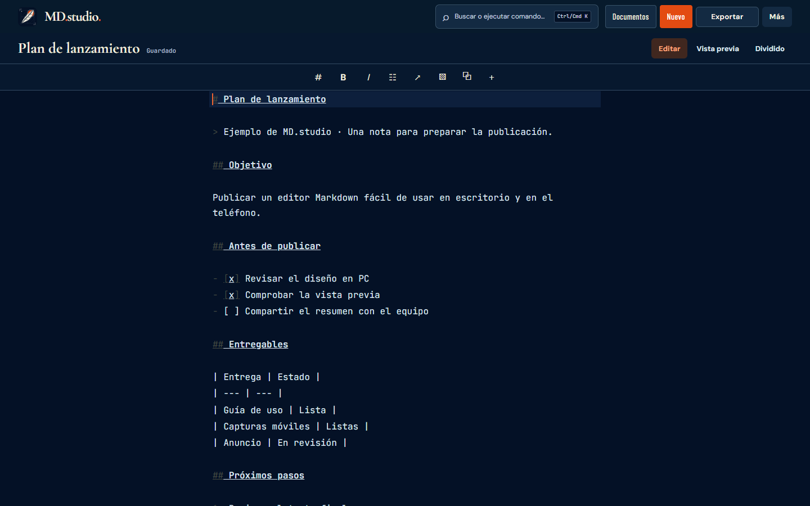](screenshots/md-studio/desktop-editor.png) | [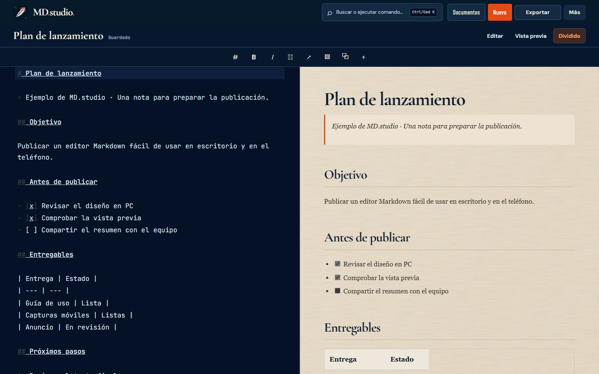](screenshots/md-studio/desktop-split.png) |

### Documentos y plantillas

**Documentos** reúne carpetas, búsqueda y filtros. **Más → Crear desde plantilla** abre estructuras listas para usar.

| Documentos | Plantillas |
| :---: | :---: |
| [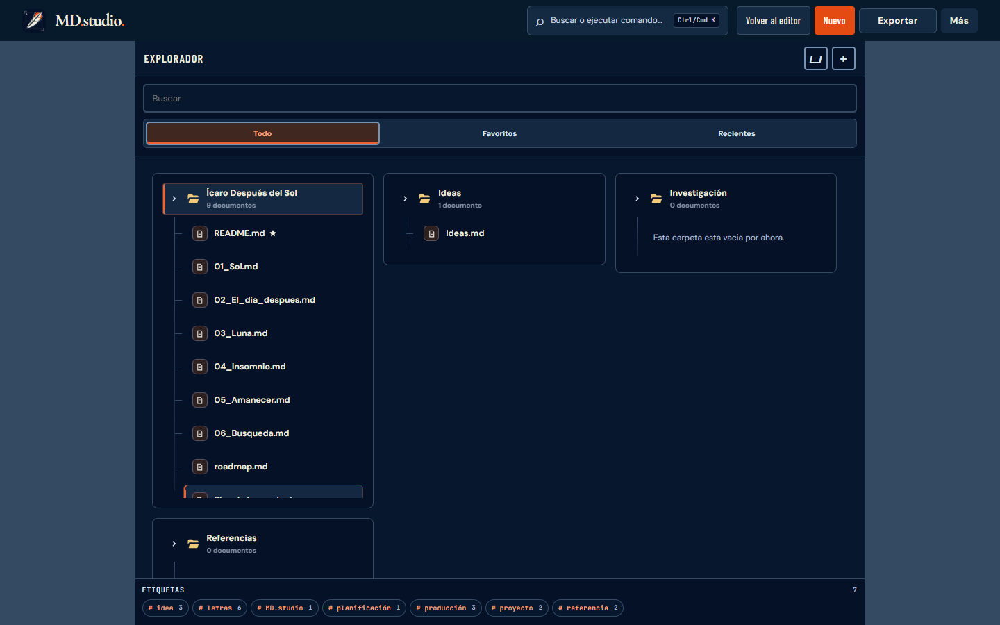](screenshots/md-studio/desktop-library.png) | [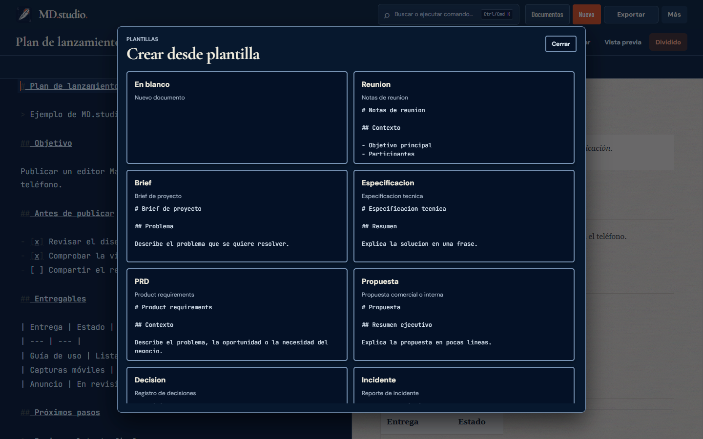](screenshots/md-studio/desktop-templates.png) |

### Exportación, historial y respaldo

| Exportar | Historial | Respaldo |
| :---: | :---: | :---: |
| [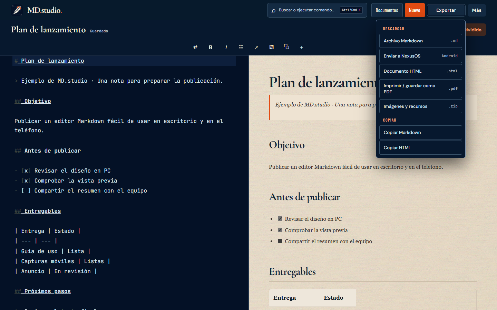](screenshots/md-studio/desktop-export.png) | [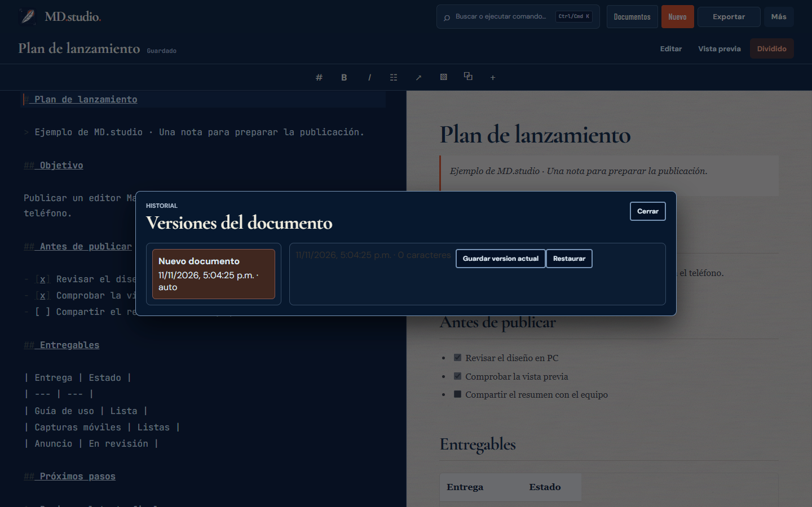](screenshots/md-studio/desktop-history.png) | [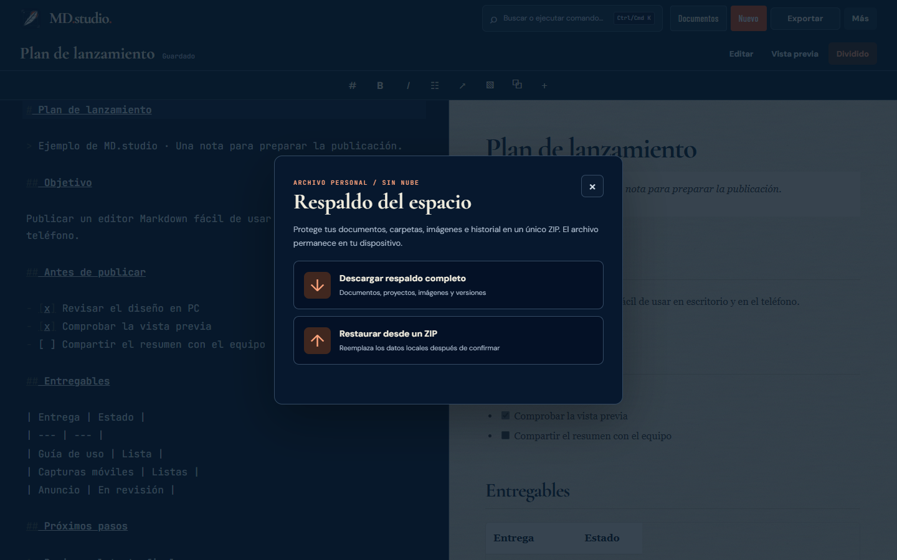](screenshots/md-studio/desktop-backup.png) |

## Móvil

### Escritura y lectura

| Editar | Vista previa |
| :---: | :---: |
| 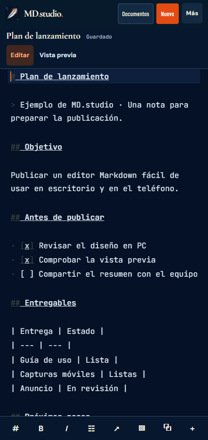 | 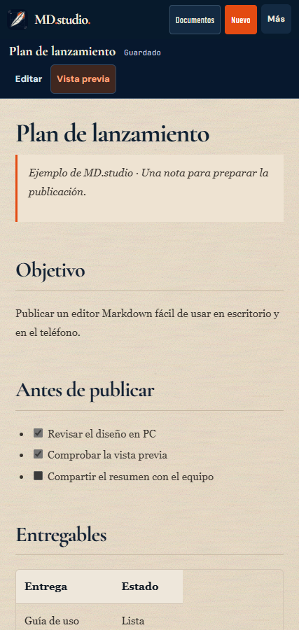 |

### Buscar y compartir

La búsqueda abre documentos por nombre o contenido. **Más → Enviar a NexusOS** entrega el título y Markdown al menú de compartir en Android compatible.

| Buscar | Más y NexusOS |
| :---: | :---: |
| 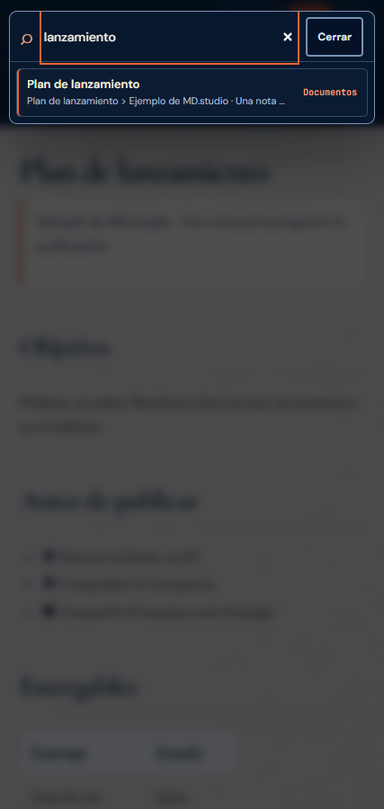 | 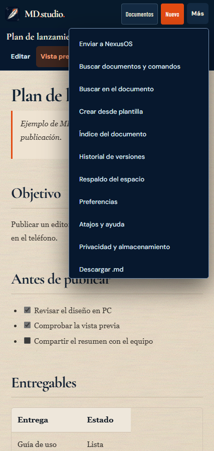 |

### Biblioteca y plantillas

| Documentos | Crear desde plantilla |
| :---: | :---: |
| 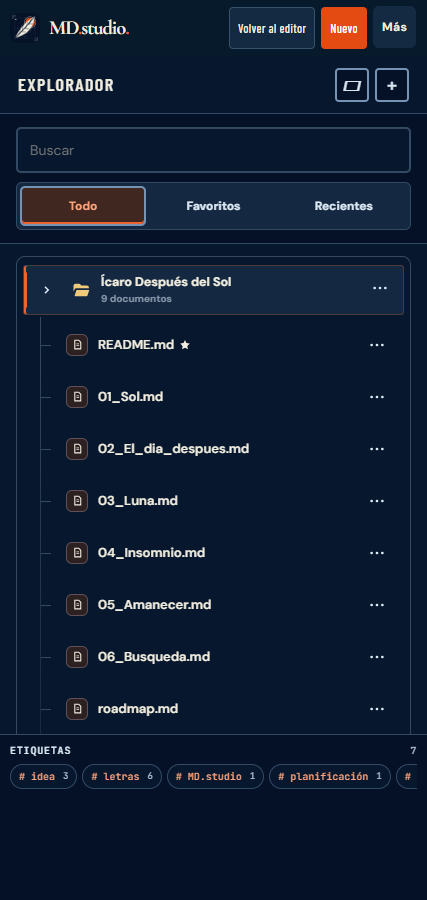 | 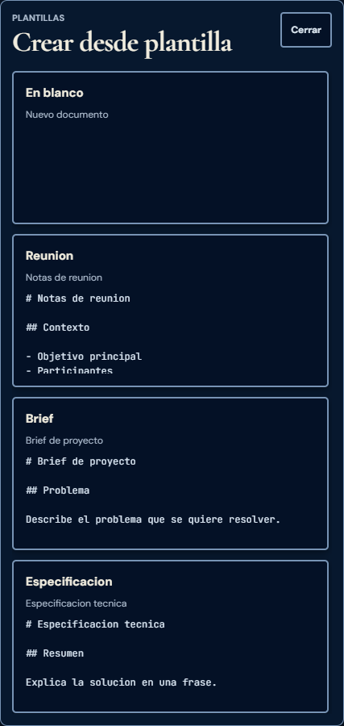 |

[Volver al README](../README.md) · [Guía de verificación](MOBILE-UI-VERIFICATION.md)
