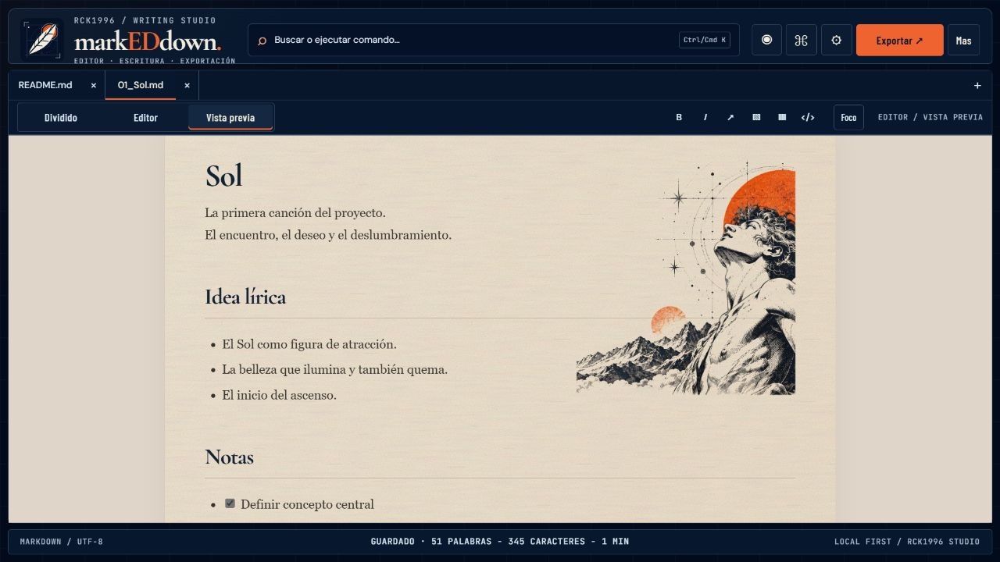
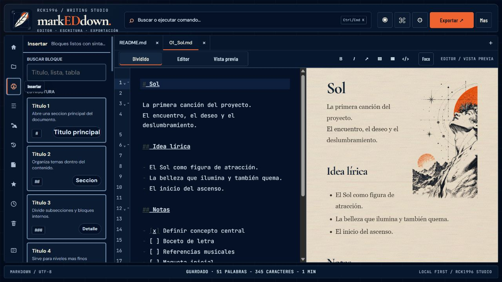
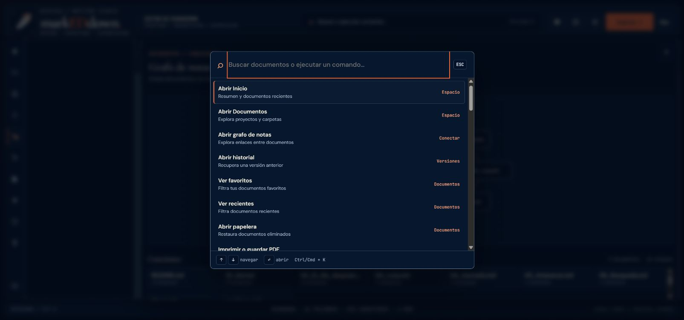
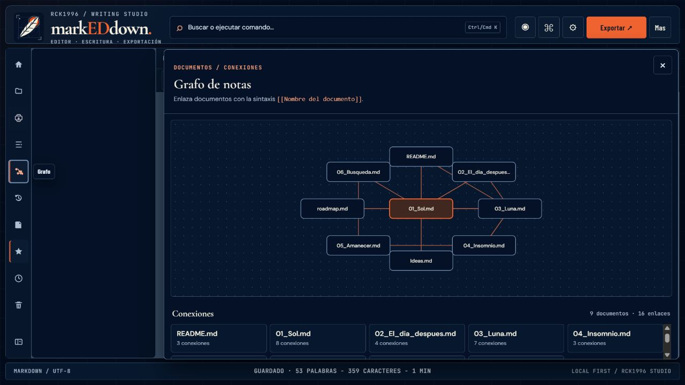
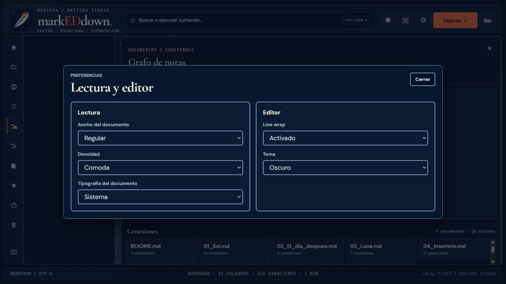
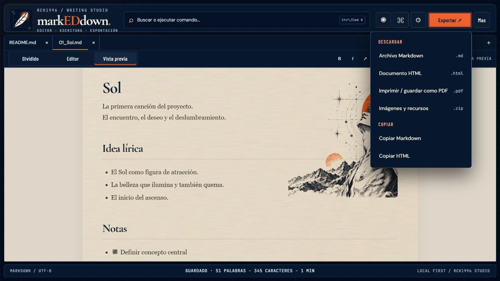

# Pantallas de markEDdown

Capturas reales de la aplicación ejecutándose en local. Se tomaron en escritorio a **1280 × 720**, con tema oscuro y documentos de muestra. Sirven para mostrar la interfaz y sus funciones; no sustituyen la matriz de pruebas responsive ni certifican cada flujo.

## Workspace dividido

Explorador de documentos a la izquierda, fuente Markdown en el centro y hoja de lectura a la derecha. La imagen editorial se integra sobre el mismo papel texturado.

## Vista previa

La hoja mantiene tono marfil y textura de fibras; el contenido queda alineado en una columna de lectura.

## Inserción de bloques

El panel **Insertar** agrupa estructuras, texto, listas y contenido, con búsqueda y ejemplos de sintaxis.

## Buscar y ejecutar comandos

La paleta reúne navegación, cambios de vista, documentos, plantillas y exportaciones.

## Grafo de documentos

Los enlaces `[[Nombre del documento]]` se convierten en nodos y conexiones navegables.

## Preferencias

Ancho de lectura, densidad, tipografía, ajuste de línea y tema se configuran por separado.

## Exportación

El menú ofrece descargas Markdown, HTML, PDF e imágenes, además de copiar Markdown o HTML.

---

[README](../README.md) · [Identidad editorial](EDITORIAL-IDENTITY.md) · [Verificación responsive](MOBILE-UI-VERIFICATION.md) · [Roadmap](ROADMAP.md)
